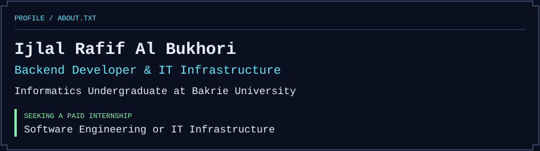
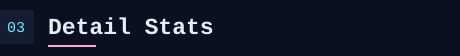
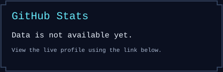
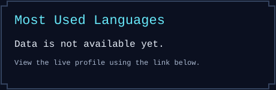
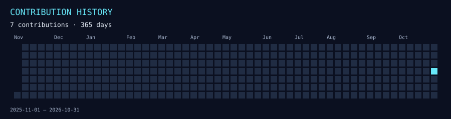
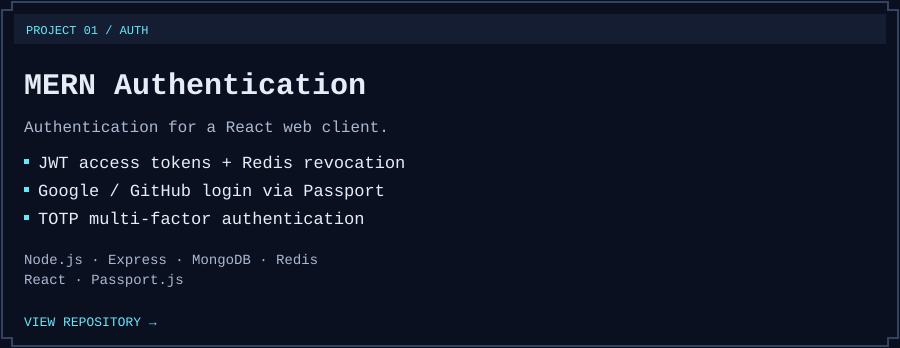
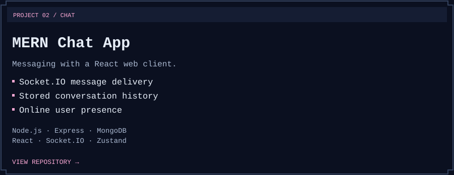
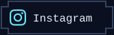

<h1 align="center">Ijlal Rafif Al Bukhori</h1>

<strong>Backend Developer &amp; IT Infrastructure</strong> · Bucoy

<picture>
  <source media="(max-width: 600px)" srcset="assets/banner-mobile.svg">
  
</picture>

<h2></h2>

<picture>
  <source media="(max-width: 600px)" srcset="assets/about-mobile.svg">
  
</picture>

I'm **Ijlal Rafif Al Bukhori**, an Informatics undergraduate at **Bakrie University**, with a background in Computer and Network Engineering from **SMK HUTAMA**. I focus on backend development and IT infrastructure, and I'm developing my skills through projects in authentication and web applications.

I'm seeking a **paid internship in software engineering or IT infrastructure**, where I can contribute to practical projects and learn from experienced engineers.

<h2></h2>

Technologies and concepts I'm learning and using:

<picture>
  <source media="(max-width: 600px)" srcset="assets/stack-mobile.svg">
  
</picture>

Read the stack as text

- **Backend:** Node.js, Express, MongoDB, MySQL, Redis, Prisma, Passport.js, JWT, Swagger; OAuth, TOTP, MFA, and rate limiting.
- **Frontend:** HTML5, CSS3, React, Tailwind CSS, Next.js.
- **Languages:** Python, JavaScript, Java, Dart, TypeScript.
- **Tools:** Linux, VS Code, Git, GitHub, MikroTik, Cloudflare Tunnel.

<h2></h2>

Language statistics describe repository code, not proficiency.

<a href="https://github.com/Bucooyyy?tab=overview"><picture><source media="(max-width: 600px)" srcset="assets/stats/contributions-mobile.svg"></picture></a>

[GitHub activity](https://github.com/Bucooyyy?tab=overview) · [Public repositories](https://github.com/Bucooyyy?tab=repositories) · [LeetCode profile](https://leetcode.com/u/Bucoyy/)

<h2></h2>

<a href="https://github.com/Bucooyyy/Mern-auth-stateless"><picture><source media="(max-width: 600px)" srcset="assets/project-auth-mobile.svg"></picture></a>

**[MERN Authentication System](https://github.com/Bucooyyy/Mern-auth-stateless)** — An authentication project with a React client, JWT access tokens, Redis-backed token revocation, Google/GitHub login through Passport, and TOTP multi-factor authentication.

<a href="https://github.com/Bucooyyy/Mern-chatapp"><picture><source media="(max-width: 600px)" srcset="assets/project-chat-mobile.svg"></picture></a>

**[MERN Chat App](https://github.com/Bucooyyy/Mern-chatapp)** — A messaging project with a React client, Socket.IO message delivery, stored conversation history, and online user presence.

<h2></h2>

Open to conversations about paid internships in software engineering and IT infrastructure.

  
  
  
  
  
  
  

