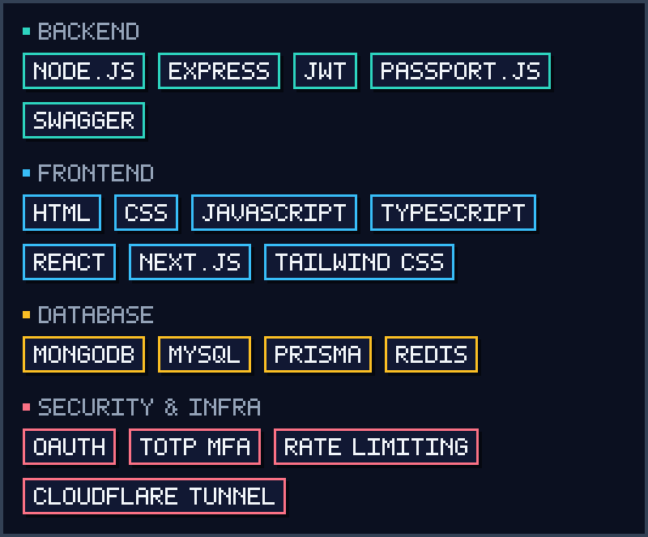

<!--
  SETUP: rename USERNAME / REPO / email / LinkedIn / portfolio placeholders below.
  This file must live in a PUBLIC repo named exactly like your GitHub username,
  together with the assets/ folder.
-->

<p align="center">
  
</p>

<p align="center">
  
</p>

```text
PLAYER   : Bucoy
CLASS    : Backend Developer / IT Infrastructure (in training)
LEVEL    : University student
QUEST    : Land a paid internship in backend or infrastructure
CURRENT  : Building secure, deployable projects for my portfolio
```

I build backend systems with a focus on **security, clean structure, and deployability**, and I document my work so that someone else can pick it up and maintain it.

- **Currently building:** a full-stack authentication system (JWT, OAuth, MFA) and an agroindustry supply chain platform.
- **Currently learning:** deployment workflows and infrastructure fundamentals, alongside deeper backend design.
- **Looking for:** a backend or IT infrastructure internship where I can contribute and learn from experienced engineers.

<p align="center">
  
</p>

<p align="center">
  
</p>

<p align="center">
  
</p>

### [MERN Authentication System](https://github.com/USERNAME/REPO)

A production-minded authentication service with a React client.

- Short-lived JWT access tokens and rotating refresh tokens (`jti` / token family IDs, SHA-256 hashed at rest), with a Redis blacklist on logout
- Local login plus OAuth via Passport.js (Google, GitHub, Discord)
- TOTP-based multi-factor authentication, email OTP verification, password reset, and three-tier role-based access
- Hardening: rate limiting, XSS and NoSQL-injection protection, Helmet, structured logging with Winston, Swagger API docs

**Stack:** Node.js · Express · MongoDB · Redis · React 19 · Vite · Tailwind CSS · shadcn/ui · Zustand

### [NusaChain](https://github.com/USERNAME/REPO)

A full-stack agroindustry supply chain platform designed for small island contexts, delivered across four RAD phases.

**Stack:** Next.js (App Router) · TypeScript · Tailwind CSS · shadcn/ui · MySQL · Prisma

<p align="center">
  
</p>

<p align="center">
  <a href="mailto:YOUR_EMAIL@example.com"></a>
  &nbsp;
  <a href="https://www.linkedin.com/in/USERNAME"></a>
  &nbsp;
  <a href="https://YOUR-PORTFOLIO.example.com"></a>
</p>

<!-- Optional: live stats (uses a third-party service; remove if you prefer a fully static profile)
<p align="center">
  
</p>
-->

<p align="center">
  
</p>
